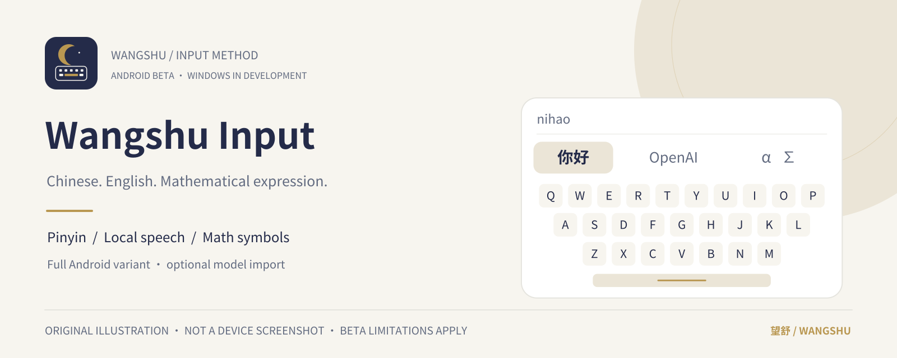
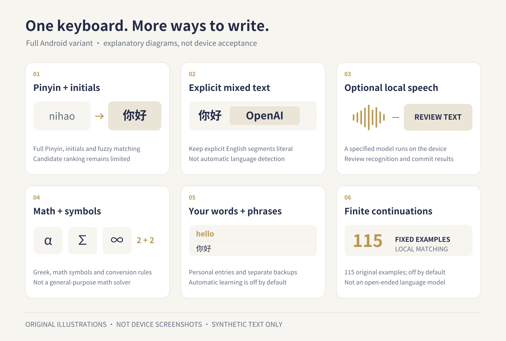

  

<h1 align="center">Wangshu Input · 望舒输入法</h1>

Chinese, English and mathematical expression, on one clear keyboard.

<a href="README.md">中文</a> · <strong>English</strong>

Wangshu is a native input-method project built around local processing. The Android beta combines Pinyin, explicit Chinese/English segments, optional offline speech and mathematical symbols. Its Windows TSF implementation is still under development and validation. Finite example matching is described as exactly that, and simulated platform tests are kept separate from real-device acceptance.

**This is an opt-in beta, not a stable store release.** Android builds are debug-signed and have known editing, speech and host-compatibility limitations. Do not use this beta for passwords, sensitive information or important text. Start with synthetic text and keep another keyboard available. Consult each release for its exact build, SHA-256 hashes and verification scope.

[Downloads and release notes](https://github.com/texasisalwaysbusy/wangshu-input/blob/main/releases/android/v0.1.0-beta.1/README.md) · [Known limitations](docs/public/BETA-STATUS.en.md) · [Privacy boundaries](docs/public/PRIVACY.en.md) · [Building](docs/public/BUILDING.md)

## What the keyboard includes

The following describes the **Android full variant's implemented scope**, not acceptance on every device or in every app.

- **Pinyin and explicit mixed input:** full Pinyin, initials-based input and configurable fuzzy matching. Explicit English segments preserve literal text, case and numbers. Abbreviated-input ranking remains limited; this is not automatic language detection.
- **Optional local speech:** import the specified Chinese/English model into the full variant for on-device recognition with sherpa-onnx. Hold-space gestures, result review and configurable right-side actions are provided. Commit behavior still has host-specific limitations.
- **Editing and symbols:** cursor and selection tools, a number panel, Greek letters, mathematical symbols, Emoji, kaomoji and rule-based mathematical text conversion. This is not a general-purpose math solver.
- **Personal words and phrases:** personal dictionaries, reusable phrases, import/export, optional candidate-frequency learning and a temporary no-learning mode. Clipboard history has a separate, off-by-default switch.
- **Bounded continuation:** optional local prediction uses 115 original Chinese, English and mixed-language examples; saved phrases can also provide continuations. It is off by default, is not an open-ended language model and does not establish general next-word quality.
- **Separate backups:** personal words/phrases and settings have separate formats. Settings use an allowlist, do not constitute a complete migration and do not automatically include every newer feature toggle.

This beta keeps unconfirmed Pinyin in the keyboard's local candidate/pre-edit area and writes it only after candidate or raw-text confirmation. This deliberately differs from host-inline composition; the hint can still be positioned above or below. Changing fields, hiding the keyboard or ending input discards unconfirmed Pinyin without deleting old-field text. No new physical-device retest followed these fixes.

*These are original explanatory illustrations, not device screenshots, exact UI layouts or evidence that a feature has passed acceptance testing.*

## Choose the right variant

| Name | Identity and scope | Speech |
| --- | --- | --- |
| **Wangshu Input · Android Full Beta** | Package `org.wangshu.ime`; full Android variant | Optional offline model; quality and compatibility remain limited |
| **Wangshu Basic Typing Preview** | Package `org.wangshu.ime.typingpreview`; separate typing preview | **Deliberately excludes speech** and does not request microphone access |
| **Windows TSF development build** | Native TSF source and development tooling; not a validated daily-use release | Android results do not establish Windows readiness |

Basic Typing Preview is not another name for the full variant and cannot substitute for its speech testing. The two Android variants have separate app data. Windows does not yet match Android's full feature set. Real-Windows registration, enablement, application compatibility and microphone acceptance remain incomplete.

## Try the Android beta

1. Open [Releases](https://github.com/texasisalwaysbusy/wangshu-input/blob/main/releases/android/v0.1.0-beta.1/README.md) and select an APK explicitly labelled **Full Beta**. Read its known issues, hashes and signing notes. A file is available only when it is actually attached to that release.
2. Android 8.0 / API 26 is the minimum. Decide whether to install it, then enable Wangshu Input in Android's keyboard settings. Read the system's input-method access warning carefully.
3. Start in an ordinary text field with non-private content, for example `nihao` → `你好`, then try the symbol panel. If commits, cursor movement or backspace behave unexpectedly, switch to your usual keyboard and check the text.
4. For offline speech, import the release's specified `wangshu-voice-zh-en-v1.zip` and grant microphone access when using speech. The model is distributed separately and is not embedded in the APK. If neither an imported model nor a supported local system recognizer is available, recognition should be unavailable rather than fall back to the cloud.

**Before updating:** signing compatibility across beta builds is not established. If Android rejects an in-place update, do not immediately uninstall to bypass the warning. First verify usable backups of your personal words, phrases and settings. Uninstalling can erase app-private data.

## Local processing has boundaries

The current Android manifest does not request `INTERNET` permission, and no account is needed. Pinyin and rule-based processing run locally. Speech audio is processed in memory for the current session, not saved as a recording history. Candidate learning and clipboard history are off by default; enabling them stores their respective local data.

An input method needs access to the current editor. The host app, operating system and any cloud file provider you select have their own behavior. Exports can contain text you entered manually; Base64 is not encryption. Offline design, password-field protections and existing tests are not an absolute security guarantee. See [Privacy and data](docs/public/PRIVACY.en.md).

## Project layout and development

- `core/`: shared C++ Pinyin, mixed composition and finite-example logic.
- `android/`: native `InputMethodService`, settings and local-data features.
- `windows/`: native TSF implementation and development checks.
- `data/`: dictionary, symbols, examples and third-party notices.
- `tests/`, `tools/`: host regressions, builds and artifact verification.

See [BUILDING](docs/public/BUILDING.md) for prerequisites, offline build entry points and the distinction between host checks and device acceptance. This is a native input-method project, not a web text box or global keyboard-hook replacement.

## Feedback

Voluntary [issues](https://github.com/texasisalwaysbusy/wangshu-input/issues) are welcome. Include the version/hash, OS and host app, synthetic reproduction text, expected behavior and actual behavior. Do not upload passwords, private recordings, chats, dictionary backups or sensitive full logs. Redact screenshots before sharing them.

## License and acknowledgments

Project code retains the repository's [Apache-2.0 license](https://github.com/texasisalwaysbusy/wangshu-input/blob/main/LICENSE). The dictionary, example corpus, speech dependencies and models have their own licenses; a distribution should not be described as having a single uniform license. Key upstream projects include CC-CEDICT, jieba, sherpa-onnx and ONNX Runtime. See [attributions and original artwork](docs/public/ATTRIBUTIONS.md).

The crescent-and-keyboard mark, banners and feature illustrations were made specifically for this project. They contain no actual input history and imply no third-party endorsement or affiliation.
