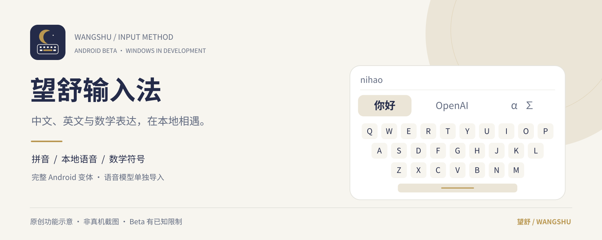
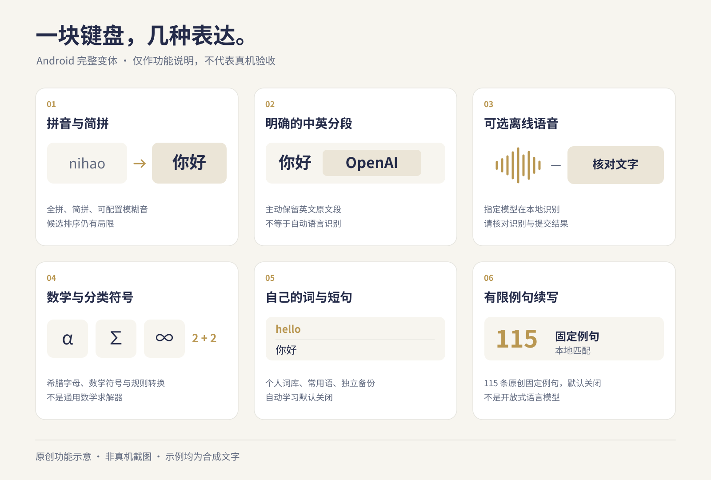

  

<h1 align="center">望舒输入法 · Wangshu Input</h1>

把中文、英文与数学表达，放在一块清楚的键盘上。

<strong>中文</strong> · <a href="README.en.md">English</a>

望舒是一个以本地处理为基础的原生输入法项目。Android beta 包含拼音输入、显式中英分段、可选离线语音和数学符号工具；Windows TSF 实现仍在开发验证中。它不把有限例句匹配称为通用 AI 预测，也不把平台模拟测试当成真实设备验收。

**当前是供自愿试用的 beta，不是商店稳定版。** Android 包使用调试签名，存在已知编辑、语音和宿主兼容问题。请勿用于密码、敏感信息或重要文本；先用合成内容了解行为，并保留常用输入法作为备选。具体构建、SHA-256 和检查范围以对应发布说明为准。

[下载与版本说明](https://github.com/texasisalwaysbusy/wangshu-input/blob/main/releases/android/v0.1.0-beta.1/README.md) · [已知限制](docs/public/BETA-STATUS.md) · [隐私边界](docs/public/PRIVACY.md) · [构建说明](docs/public/BUILDING.md)

## 这块键盘能做什么

以下为 **Android 完整变体的功能范围**，不代表每一项已在所有设备与应用中验证。

- **拼音与中英分段**：全拼、简拼和可配置模糊音；可显式切换英文原文段，保留大小写与数字。简拼候选排序仍有限，不是自动语言识别。
- **可选本地语音**：完整变体可导入指定的中英离线模型，使用 sherpa-onnx 在设备上识别。提供长按空格、核对结果和可配置右侧动作；具体提交行为仍有宿主兼容限制。
- **编辑与符号**：光标和选择工具、数字面板、希腊字母、数学符号、Emoji、颜文字，以及规则式数学文本转换。它不是通用数学求解器。
- **自己的词与短句**：个人词库、常用语、导入导出、可选词频学习、临时不学习。剪贴板历史另有默认关闭的开关。
- **有边界的续写**：可选的本地例句预测使用 115 条原创中英及混合例句；常用语也可匹配续写。此能力默认关闭，不是开放式语言模型，不保证任意句子的下一词质量。
- **独立备份**：个人词库/常用语与设置分别备份。设置备份是白名单格式，不是整机迁移，也不自动包含所有新功能开关。

此 beta 将未确认拼音保留在键盘候选栏中，确认候选或原文后才写入编辑框。这与宿主内联拼音显示不同；键盘内提示仍可选择上下位置。换字段、隐藏键盘或结束输入会丢弃未确认拼音，不尝试删除旧字段正文。修复后没有新增真机复验。

*以上图片为项目原创功能示意，不是真机截图，也不表示当前界面的像素布局或功能验收结果。*

## 选对版本

| 名称 | 身份与范围 | 语音 |
| --- | --- | --- |
| **Wangshu Input · Android Full Beta** | 包名 `org.wangshu.ime`，Android 完整变体 | 可选离线模型；识别质量与兼容性仍有限 |
| **Wangshu Basic Typing Preview** | 包名 `org.wangshu.ime.typingpreview`，独立基础打字预览 | **刻意不含语音**，不请求麦克风权限 |
| **Windows TSF 开发版** | 原生 TSF 源码与开发工具；不是已验收的日用版本 | 不可从 Android 结果推断 Windows 可用性 |

Basic Typing Preview 不是完整变体的别名，也不能代替完整变体的语音测试。两者使用独立应用数据。Windows 与 Android 尚未功能对齐，真实 Windows 注册、启用、应用兼容和麦克风验证仍未完成。

## 开始试用 Android beta

1. 在 [Releases](https://github.com/texasisalwaysbusy/wangshu-input/blob/main/releases/android/v0.1.0-beta.1/README.md) 选择明确标注 **Full Beta** 的 APK。先阅读该版本的已知问题、文件哈希和签名说明；只有实际附带的文件才是可下载产物。
2. Android 最低版本为 8.0 / API 26。由你决定是否安装，并在系统输入法设置中启用“望舒输入法”。认真阅读 Android 的输入法访问提示。
3. 先在不含私人内容的普通文本框尝试 `nihao` → `你好`，再尝试符号面板。遇到提交、光标或退格异常时，切回原输入法并核对文本。
4. 如需离线语音，导入该版本说明中指定的 `wangshu-voice-zh-en-v1.zip`，仅在使用语音时授予麦克风权限。模型与 APK 分开发放，模型不内置于 APK。没有可用模型或本机离线服务时，应提示不可用，不改走云端识别。

**更新前请注意：** beta 的跨构建签名兼容性尚未建立。若 Android 拒绝覆盖安装，不要直接卸载以绕过提示；先确认个人词库、常用语与设置已有可用备份。卸载可能丢失应用私有数据。

## 本地处理，不等于没有隐私边界

当前 Android 清单不声明 `INTERNET` 权限，无需账户。拼音和规则处理在本地；语音录音用于当前会话的内存处理，不作为录音历史保存。自动候选学习与剪贴板历史默认关闭，启用后会保存各自的本地数据。

输入法需要访问当前编辑框。宿主应用、操作系统以及你在系统文件选择器中选用的云盘服务各有自己的行为。备份可能包含你手动输入的文字，Base64 不是加密。离线设计、密码字段保护和现有测试均不构成“绝对安全”的保证。详见 [隐私与数据说明](docs/public/PRIVACY.md)。

## 项目结构与开发

- `core/`：共享 C++ 拼音、混合组合与有限例句逻辑。
- `android/`：原生 `InputMethodService`、设置与本地数据功能。
- `windows/`：原生 TSF 实现及开发检查工具。
- `data/`：词典、符号、例句与第三方归属说明。
- `tests/`、`tools/`：主机回归、构建和产物核验工具。

构建依赖、离线构建入口和“主机检查不等于真机通过”的说明见 [BUILDING](docs/public/BUILDING.md)。这是原生输入法项目，不以网页输入框或全局键盘钩子替代系统输入服务。

## 反馈

欢迎自愿提交 [Issue](https://github.com/texasisalwaysbusy/wangshu-input/issues)，注明版本/哈希、Android 或 Windows 版本、宿主应用、合成复现文字、预期与实际结果。请勿上传密码、私人录音、聊天记录、词库备份或含敏感信息的完整日志。截图请先遮盖私人内容。

## 许可与致谢

项目代码沿用仓库的 [Apache-2.0 许可](https://github.com/texasisalwaysbusy/wangshu-input/blob/main/LICENSE)。词典、例句、语音依赖和模型各自遵循对应许可，不应把整个发行包笼统称为只有一种许可。主要来源包括 CC-CEDICT、jieba、sherpa-onnx 和 ONNX Runtime，详见 [第三方与图片归属](docs/public/ATTRIBUTIONS.md)。

月牙与键盘标志、横幅和功能示意为本项目专门绘制的原创矢量设计。它们不使用真实输入记录，也不表示任何第三方的认可或合作关系。
